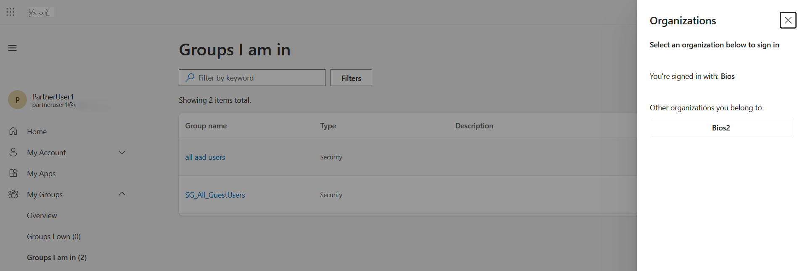
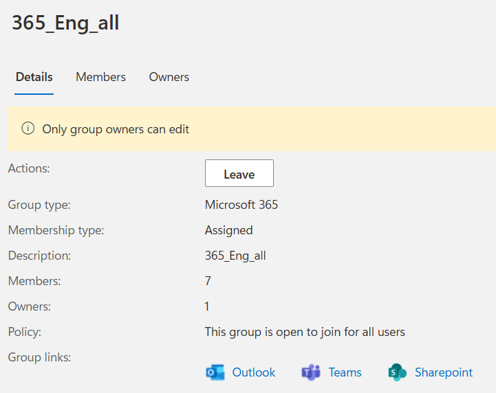
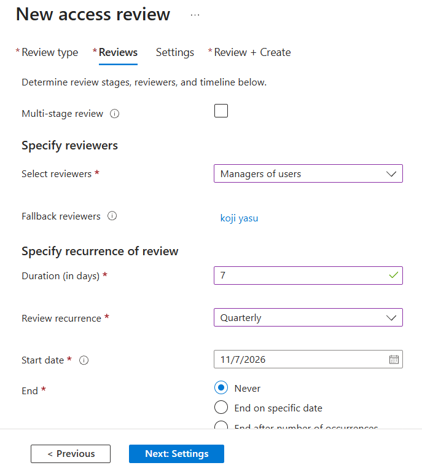
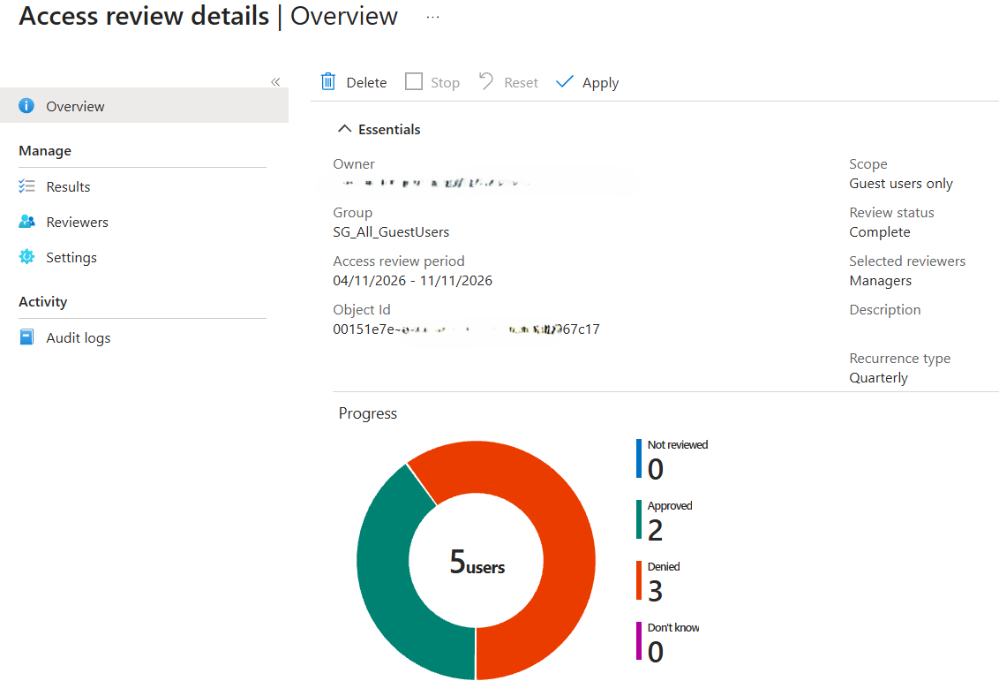
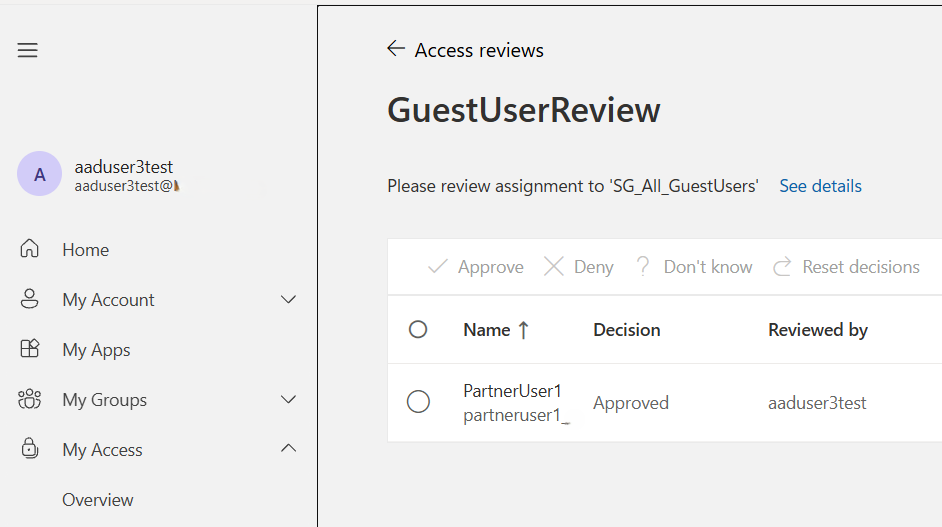
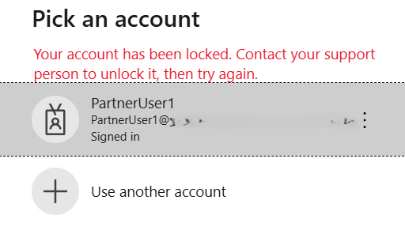

> Labbed: Nov 2026

# Scenario

This lab simulates the onboarding and lifecycle management of external guest users in Microsoft Entra ID.

An internal manager submits a guest onboarding request through ServiceNow. Once approved, the IT team provisions the guest using PowerShell and Microsoft Graph, assigns the requesting manager to the guest's Manager attribute, and configures periodic access reviews.

### Tenants:

Resource tenant: Bios

External tenant: Bios2

---

# 1. Guest Onboarding Request (Hypothetical)

An internal Bios manager submits a ServiceNow ticket requesting access for an external partner. In this hypothetical workflow, an approved ServiceNow request is exported to a CSV file for the IT team to process.

The csv file includes:

- Guest email address and display name
- Internal manager responsible for the guest

After approval, the IT team prepares the guest account provisioning.

---

# 2. Guest Provisioning with PowerShell

### 2.1 Prepare the CSV

Created [Guest_Invitation_Requests.csv](https://github.com/YK7188/YK_Lab/blob/main/docs/images/39-EntraGuest_LifecycleManagement/Guest_Invitation_Requests.csv) to simulate an export of approved ServiceNow requests.

GuestEmail,DisplayName,ManagerUPN

### 2.2 Provisioning script

Created 
[InviteGuests.ps1](https://github.com/YK7188/YK_Lab/blob/main/docs/images/39-EntraGuest_LifecycleManagement/InviteGuests.ps1)
 using Microsoft Graph PowerShell.

The script:

- Connects to Microsoft Graph using delegated authentication (pop-up for sign-in).
- Reads the approved requests from the CSV.
- Checks for existing guest accounts and validates the manager.
- Invites new guests and sends invitation emails.
- Assigns the internal Bios manager to each guest.
- Exports the results to a timestamped CSV file.

### 2.3 Execute the script

```
.\InviteGuests.ps1
```


---

# 3. Verify Guest Provisioning

Confirmed that PartnerUser1 was created as a guest account in Bios.

Verified:
- User type: Guest
- Internal manager: AADUser3test
- Invitation status: Pending acceptance > Accepted (after redemption)
- Access to the Bios tenant and group visibility

The external user opens the invitation link, authenticates with their home tenant account, and completes the invitation redemption process. Now, the user can switch the tenant where they need to access resources as shown below.



The guest user could access SharePoint and Teams through shared links, but not Outlook, as no Microsoft 365 license was assigned in either tenant.



---

# 4. Configure Guest Access Reviews

To identify guest accounts that are no longer required, configure a quarterly access review.

### 4.1 Create a dynamic guest group

Entra ID > Groups > All groups

For a test, created SG_All_GuestUsers with dynamic user membership: user.userType -eq "Guest"

### 4.2 Configure the access review

Entra ID > ID Governance > Access reviews

Created GuestUserReview as below.

|Setting|Choice|
|---|---|
|Resource|	SG_All_GuestUsers|
|Scope|	Guest users only|
|Reviewers|	Managers of users|
|Frequency|	Quarterly|
|Review duration|	7 days|
|Auto apply results to resource|Enabled|
|Denied guest action|	Block sign-in for 30 days, then remove from tenant|
|If reviewers don't respond|	Remove access|

<br>


> If ***Auto apply results to resource*** is set to Disabled, an administrator needs to manually apply the review result as shown below.

<br>


### 4.3 Test manager approval

Signed in as AADUser3test, the assigned manager of PartnerUser1.

The manager received an access review notification and opened the review through My Access. Approved PartnerUser1's continued access.



### 4.4 Offboarding

The guest's manager submits an offboarding request through ServiceNow when access is no longer required. Quarterly access reviews provide an additional safeguard. If a reviewer fails to respond, the guest is subject to the configured removal process after the review period ends.

After the review period ended, the configured action was applied, and the denied guest account was disabled. When the guest attempted to switch to the Bios tenant, the message ***Your account has been locked*** appeared as shown below.



> The disabled guest account was manually re-enabled in Entra ID, and access to SharePoint and Teams was successfully restored.
> According to Microsoft documentation, restoring guest access during the 30-day grace period also prevents the scheduled deletion. However, whether all previously assigned resource permissions are preserved was not fully tested.

---

# Conclusion

This lab demonstrated a simulated enterprise B2B guest lifecycle covering approved onboarding requests, Microsoft Graph provisioning, resource access, manager assignment, and recurring access reviews.


